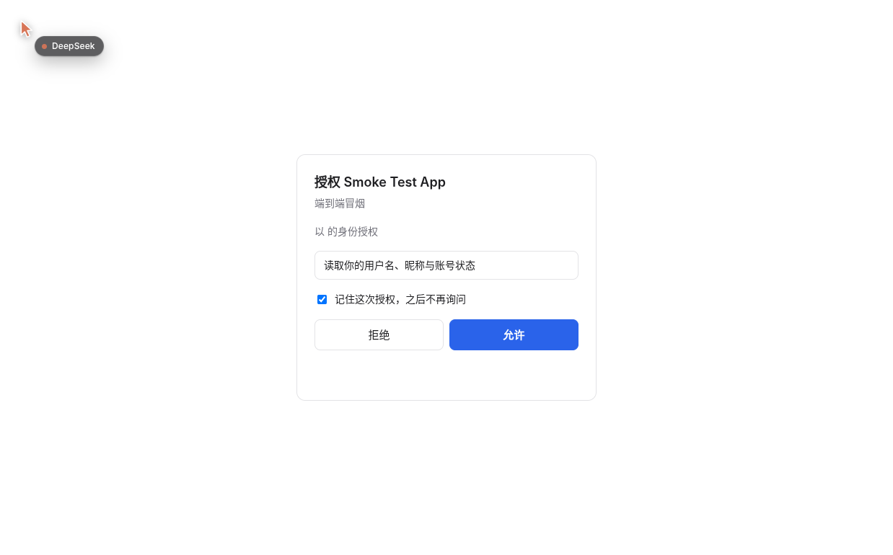
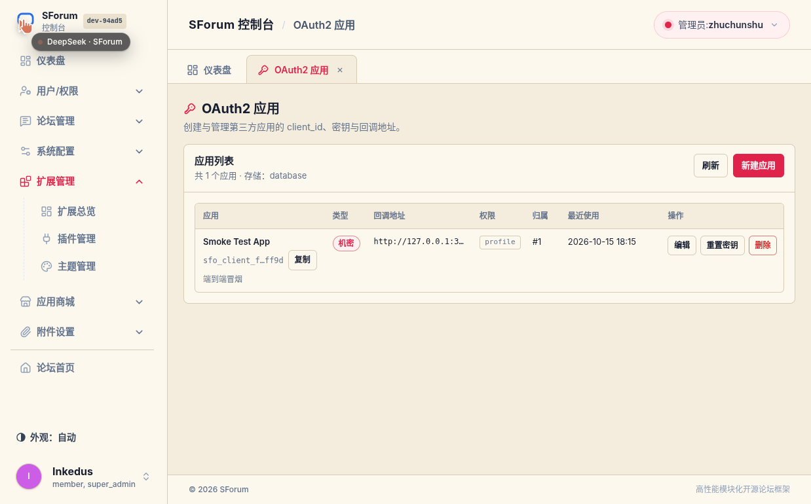
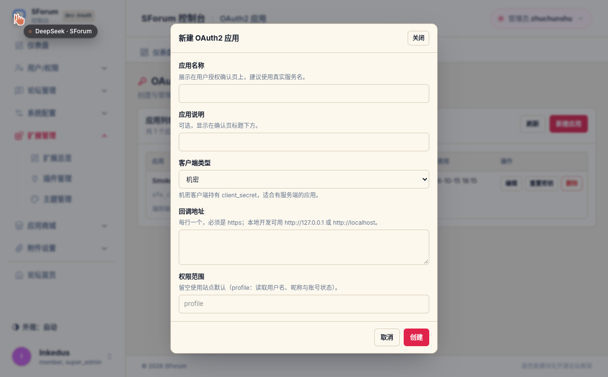
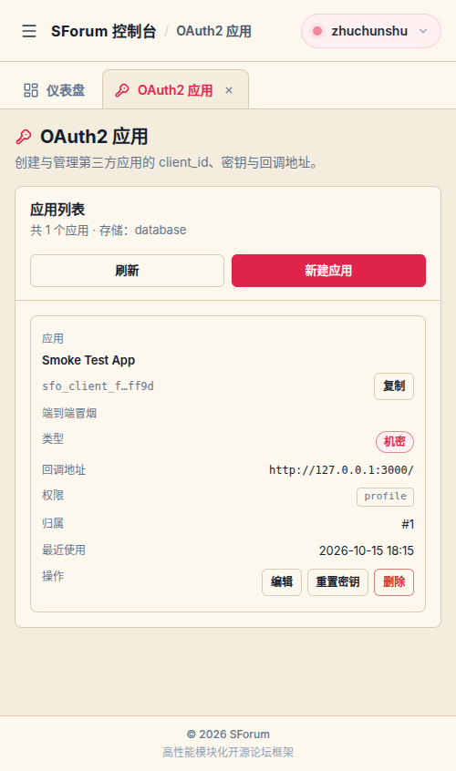

# SForum OAuth2 Provider

[](https://github.com/keeptrue/sforum-oauth2-provider/actions/workflows/ci.yml)
[](https://github.com/keeptrue/sforum-oauth2-provider/releases)


让 **SForum 作为 OAuth2 授权服务器**（类似 GitHub OAuth Apps）：第三方应用通过授权码 + PKCE
拿到访问令牌，再调用 userinfo 读取用户资料。账号、密码与会话始终由 SForum 持有，插件不接触用户凭据。

- 形态：SForum 扩展包（Manifest V3 + Protocol V2 后端），`own_schema` 数据库租约，无第三方 OAuth2 依赖。
- 功能：授权码 + PKCE、刷新令牌轮换、令牌撤销（RFC 7009）、令牌内省（RFC 7662）、
  应用管理（管理员管全部 + 用户自助）、授权确认页、已授权应用与撤销、
  应用图标（可直接上传图片，也可填写图片地址，未设置时按统一规范自动生成）。
- 安全：密钥与令牌只存 SHA-256 哈希；回调地址精确匹配；授权码一次性；常量时间比较。

| 授权确认页 | 管理端应用列表 |
| --- | --- |
|  |  |

## 安装

1. 从 [Releases](https://github.com/keeptrue/sforum-oauth2-provider/releases) 下载与服务器平台匹配的压缩包
   （`linux_amd64` / `linux_arm64` / `darwin_arm64` / `darwin_amd64`），校验 `sha256sum -c SHA256SUMS`。
2. 装到 SForum（两种方式任选）：
   - **上传**：后台「插件管理 → 安装插件」选择 zip；
   - **外部源**：解压到某个外部源根的 `plugins/sforum-oauth2-provider/`，然后重启 API；
     或者直接把本仓库路径加进 `EXTERNAL_EXTENSION_ROOTS`（本仓库根就是源根）。
3. 后台启用 **OAuth2 Provider**，按宿主提示完成一次 exact-artifact `super_admin` 信任确认
   （`授权当前精确制品` → `确认并启用`）。
4. 需要“管理全部应用”的角色，到「角色权限」授予 `sforum.oauth2-provider.manage_clients`。

包内容变化会生成新的候选制品，需要重新确认信任；**版本号不变只改内容时**用「禁用 → 升级 → 启用」
切换（`重启` 不会切换制品）。

## 端点

| 端点 | 方法 | Guard | 说明 |
| --- | --- | --- | --- |
| `/api/oauth/authorize` | GET | public | 授权入口。未登录跳 `/login?redirect=…`；需确认跳确认页；已授权直接回跳并带 `code` |
| `/api/oauth/consent` | GET | login | 授权确认页（`mode: stream`，自包含 HTML）；`?request=…&return=…`，`return` 是原始授权请求（已校验为本站授权端点），供「切换账号」退出后回到同一请求 |
| `/api/oauth/consent/summary` | GET | login | 确认页数据：应用名、请求的权限、当前用户 |
| `/api/oauth/consent/decision` | POST | login | 允许 / 拒绝，返回回跳地址 |
| `/api/oauth/token` | POST | public | 授权码兑换、刷新令牌轮换 |
| `/api/oauth/userinfo` | GET | public | 读取用户资料（`access_token` 参数） |
| `/api/oauth/revoke` | POST | public | RFC 7009 撤销令牌 |
| `/api/oauth/introspect` | POST | public | RFC 7662 令牌内省 |
| `/api/oauth/csrf` | GET | public | 非浏览器客户端的 CSRF 握手端点 |
| `/api/oauth/docs` | GET | public | 接入说明页的数据端点：scope / 端点 / 错误码三张表。页面本身是宿主公开页 `/docs/oauth2-provider` |
| `/api/oauth/clients` | GET | login | 应用列表（管理员看全部，用户看自己的） |
| `/api/oauth/clients/create` | POST | login | 创建应用（返回一次性明文密钥） |
| `/api/oauth/clients/update` | POST | login | 更新名称、说明、图标、回调地址、权限 |
| `/api/oauth/clients/rotate-secret` | POST | login | 重置密钥（返回一次性明文密钥） |
| `/api/oauth/clients/delete` | POST | login | 删除应用（同时清理令牌与授权） |
| `/api/oauth/authorizations` | GET | login | 我已授权的应用 |
| `/api/oauth/authorizations/revoke` | POST | login | 撤销我对某应用的授权并作废其令牌 |

权限键 `sforum.oauth2-provider.manage_clients` 由插件声明、由宿主授权；插件的安装/启用代码不会
自行授予任何角色。

## 第三方应用接入

站内有一份面向接入方的说明页：`/docs/oauth2-provider`（`access: public`，无需登录；管理端
「OAuth2 应用」页头也有入口）。页面是**宿主公开页**——页头、页脚、站点布局与主题全部由 Core
渲染，正文由宿主模板 `templates/oauth-docs.html` SSR 输出（沿用 Core `.sf-prose` 长文排版，
容器加宽到 960px），首帧即有完整内容；包内 L2 组件 `frontend/public/docs.mjs` 只负责把示例
域名替换为当前站点、并把 scope / 端点 / 错误码三张表填进模板骨架——三张表来自
`GET /api/oauth/docs`，由 `scopeRegistry`、清单 `routes[]` 与错误分支在运行时生成，
`docs_test.go` 做双向漂移守卫。下面这份 README 保留给维护者，讲实现与约束。

### 1. 建应用

管理员或用户创建应用，得到 `client_id` 与一次性 `client_secret`（公开客户端无密钥，必须用 PKCE）。
回调地址必须是 `https`，本地开发允许 `http://127.0.0.1` / `http://localhost`。

**应用图标**：三种来源，优先级从高到低——**上传图片** > **填写图片地址** > **自动生成**。
上传与地址互斥，一次保存只生效一个；切换来源时旧的一侧会被清理（附件会先 release，
不留孤儿引用）。

- **上传**：PNG / JPEG / WebP，≤512 KiB。浏览器把文件直接 POST 到 SForum Core 的
  `/api/v1/attachments`，插件只把返回的 `publicId` 通过 Host Command
  `sforum.attachments.extension.claim@1` 登记成「本扩展拥有的公开资产」，自己的库只存
  `publicId`。对象存储、出图、变体、引用计数与孤儿回收全部由 Core 持有——
  插件不存字节、不存 URL、也没有自己的上传路由。
- **地址**：`logoUrl`（https 图片地址，本地开发允许 loopback http，不带 fragment，≤2048 字符）。
  旧宿主没有上述 Host Command 时会给出可读提示并引导改用地址，**不会**退回 base64 内联。
- **自动生成**：两者都没有时按统一规范生成 **GitHub 风格的 identicon**——方型浅灰纯色底
  （`#f0f0f0`，无渐变）+ 5×5 镜像像素块（单色、哈希决定色相；布局/边距/填充规则对齐
  GitHub 默认头像，色块 S/L 取自 GitHub 实测区间）。同一应用图案与颜色稳定，不同应用自然错开。

图标渲染描述符由后端统一下发（`icon` 字段，含 `kind=attachment|url|generated` 与
`pattern/background/color`，地址与上传形态另有 `url`），授权确认页、前台
「我的应用 / 已授权」卡片与管理端列表三处共用；图片加载失败自动回退生成图标。消费端对地址类图标会直接向图片域名发起请求
（`referrerpolicy=no-referrer`），上传类图标走本站 `/media/attachments/<publicId>`。

> ⚠️ 上传能力依赖 `database.grants` 里的 `host_commands`。从 1.1.x 升到 1.2.0 时，
> exact-artifact 的授权影响面变了，**升级/启用需要重新做一次 super_admin 信任确认**。

### 2. 浏览器授权

```
https://站点域名/api/oauth/authorize
  ?client_id=sfo_client_xxx
  &redirect_uri=https%3A%2F%2Fapp.example.com%2Fcallback
  &response_type=code
  &scope=profile
  &state=随机串
  &code_challenge=BASE64URL_SHA256(code_verifier)   # 公开客户端必填
  &code_challenge_method=S256
```

`scope` 可省略。省略时服务端回落到「应用登记的权限范围」（见下节），所以应用在后台勾了
哪些权限，确认页就列出哪些。

### 权限范围（scope）

`scope` 是空格分隔的清单，三层约束从内到外：

1. **应用登记范围**（后台 → OAuth2 → OAuth2 应用 → 权限范围）：该应用**可申请**的权限。
   授权请求里的 `scope` 超出这份清单会被 `invalid_scope` 拒绝（错误按 RFC 6749 §4.1.2.1
   回跳到已登记的回调地址）。没有这一层，任何持有 `client_id` 的应用都能索取站点开放的
   全部权限，后台的勾选形同虚设。
2. **缺省值**：请求不带 `scope` 时，服务端用应用登记的范围作为默认值（RFC 6749 §3.3 允许
   服务端预定义默认值）。
3. **站点清单** `allowed_scopes`：硬上限，管理员只能收窄可选范围；`profile` 是身份基底，
   始终允许、始终授予。

已实现的范围：`profile`（必选）、`email`、`avatar`、`topic.count`、`comment.count`、`users.groups`。
`email` 是敏感范围：确认页会明确列出「读取你的邮箱地址与验证状态」，用户同意后服务端在签发
授权码时**读取一次并保存**（不会持续读取），之后 userinfo 只读这份快照。
确认页与后台 chip 的文案都来自 `backend/constants.go` 的 `scopeRegistry`（`DescZh` 给后台，
`LabelZh` 给确认页），新增范围在那里登记一行即可。

### 3. 换取令牌

```bash
# 非浏览器客户端先做 CSRF 握手：GET 会种下 csrf_ cookie（HttpOnly=false）
curl -c jar.txt https://站点域名/api/oauth/csrf

CSRF=$(awk '$6=="csrf_" {print $7}' jar.txt)
curl -b jar.txt -X POST https://站点域名/api/oauth/token \
  -H "Content-Type: application/json" \
  -H "X-Csrf-Token: $CSRF" \
  -H "Origin: https://站点域名" \
  -d '{
    "grant_type": "authorization_code",
    "client_id": "sfo_client_xxx",
    "client_secret": "sfos_xxx",
    "code": "sfoc_xxx",
    "redirect_uri": "https://app.example.com/callback",
    "code_verifier": "原始 verifier"
  }'
```

响应：`{ "access_token": "sfoa_…", "token_type": "Bearer", "expires_in": 3600, "refresh_token": "sfor_…", "scope": "profile" }`。
刷新用 `grant_type=refresh_token`；刷新令牌每次使用都会轮换，旧的立即失效。

### 4. 读取用户资料

```bash
curl "https://站点域名/api/oauth/userinfo?access_token=sfoa_xxx"
```

```json
{
  "sub": "7",
  "id": 7,
  "username": "alice",
  "displayName": "Alice",
  "status": "active",
  "createdAt": "2026-01-02T03:04:05.123456789Z",
  "updatedAt": "2026-02-03T04:05:06Z",
  "profileUrl": "https://站点域名/u/alice",
  "email": "alice@example.com",
  "emailVerified": true,
  "scope": "profile email avatar",
  "clientId": "sfo_client_xxx",
  "avatar": "data:image/svg+xml;base64,PHN2ZyB4bWxucz0i…"
}
```

字段与 GitHub `/user` 的对应关系：

| 字段 | 恒在 | GitHub 对应 | 说明 |
| --- | --- | --- | --- |
| `sub` | ✅ | `id`（字符串形态） | 本站用户 id 的字符串形式（OIDC 风格） |
| `id` | ✅ | `id` | 与 `sub` 同值的数字形态 |
| `username` | ✅ | `login` | 登录名 |
| `displayName` | ✅ | `name` | 昵称，为空时回落成 `username` |
| `status` | ✅ | — | `active` / `disabled` / `banned` |
| `scope` / `clientId` | ✅ | — | 本次令牌的授权范围与客户端标识 |
| `createdAt` | ⚠️ 宿主能给才在 | `created_at` | 注册时间（UTC，RFC 3339） |
| `updatedAt` | ⚠️ 同上 | `updated_at` | 账号资料最后更新时间 |
| `profileUrl` | ⚠️ 能解析站点地址才在 | `html_url` | 站内公开主页 `{site.url}/u/{username}` |
| `email` | 授予 `email` 且在授权时读到才在 | `email` | 授权时快照的本人邮箱 |
| `emailVerified` | 随 `email` | —（OIDC 同名） | 该邮箱是否已验证；与 `email` 同进同出 |
| `avatar` | 授予 `avatar` 时恒在 | `avatar_url` | 见下表 |
| `groups` | 授予 `users.groups` 时 | —（近似 orgs） | 用户组标识数组 |
| `topicCount` / `commentCount` | 授予对应范围时 | `public_repos` / `public_gists`（近似） | 公开内容计数 |

`createdAt`/`updatedAt` 来自宿主的稳定查询 `sforum.core.safe_user.by_id`（清单需声明
`core_views` 授权）。宿主给不出时（旧宿主、授权未确认、用户不是 `active` 状态）这两个字段
**整体缺席**，其余字段与 200 状态不变——第三方据此区分「宿主没给」和「用户没有注册时间」。

`profileUrl` 依赖站点公开地址（同 `avatar` 的解析链）；解析不出来时字段缺席，不猜域名。

**不提供的字段**：`email` / `email_verified` / `bio` / `location` / `website` / `locale` /
`followers` 等。邮箱这类敏感字段在宿主侧只走 actor 门控面，而插件 → 宿主的调用必须
actorless，所以 v1 拿不到；`bio`/`location`/`website` 是公开数据但还没有插件可读面。
详见 `NOTES.md` 的「已知未覆盖项」。

授予 `avatar` 范围时 `avatar` **始终存在**，取值按来源区分：

| 用户头像来源 | `avatar` 值 |
| --- | --- |
| 上传过头像 | 绝对地址 `https://站点域名/media/avatars/<publicId>`（插件把宿主的相对路径补全） |
| 站点默认 Gravatar / 静态图 | 对应绝对地址 |
| 默认首字头像（`avatar.default_provider=initials`，默认安装即如此） | 插件按显示名生成的确定性 GitHub 风格 identicon（`data:image/svg+xml;base64,…`），可直接用作 `` |

未授予 `avatar` 时该字段不出现。相对路径的补全顺序：宿主公开选项 `site.url`
（`GET {APP_URL}/api/v1/web-options/site.url`，后台覆盖过就以覆盖值为准）→ 进程环境
`APP_URL`；两者都拿不到时保留相对路径，不猜测域名。解析结果缓存 5 分钟。
兜底头像是与应用图标一致的 GitHub 风格 identicon（浅灰方底 + 5×5 镜像像素块，无文字），
种子是显示名；同一用户永远得到同一张图，显示名变化时才会变。

## Host 约束（实测，决定了本插件的实现方式）

1. **访问令牌用查询参数交付**：插件路由默认以 `filtered` authority 运行，会剥离 `Cookie` 与
   `Authorization`；`core.guard.raw_request` 在当前宿主版本关闭，因此 `userinfo` 只能用
   `access_token` 查询参数（RFC 6750 §2.3 允许的形式）认证。
2. **所有插件路由都受宿主 CSRF 中间件保护**：服务端到服务端的 `POST /api/oauth/token` 必须先
   `GET /api/oauth/csrf` 拿 `csrf_` cookie，再带 `X-Csrf-Token` 与 `Origin`。宿主只豁免
   `/api/v1/webhooks/inbound/*` 与站点 PAT（`Bearer sft_…`）。
3. **wire 层 schema 引用必须是版本化契约 `id@N`**：包内路径（`schemas/x.json`）能过清单校验，
   但分发时报 `protocol v2 schema reference … is invalid`。所以路由的 `requestSchema`/`responseSchema`
   统一用 `sforum.oauth2-provider.route.*@1`，并随包提供 `openapi/routes.yaml` 为每条路由声明
   operation；每条 operation 必须有一个带 schema 的 **2xx** 响应，再加 `default` 让 302/4xx/5xx
   也能命中回退。
4. **HTTP 响应必须自带 `Content-Type: application/json`**（恰好一个），否则分发时
   `extensions.route_schema_invalid`。`action: add` 的路由无论 `mode`（含 `stream`）都必须声明
   `responseSchema`，否则路由注册表准入被拒。
5. **插件 → 宿主的调用必须 actorless**：宿主拒绝携带 Actor 的插件请求
   （`protocol v2 actor context is not host-attested`），因此读设置与用户资料时必须清空
   `RequestContext.Actor`（core 安全字段不需要 actor）。
6. **授权确认页由 `mode: stream` 承载**：宿主对 `mode: http` 的响应强制 JSON 校验，公共资产端点
   也不服务 `.html`；`stream` 模式的正文是不透明数据块，preflight 可声明 `Content-Type: text/html`。
7. **PKCE S256 用 base64url**（RFC 7636 §4.2，无填充）；单元测试同时断言十六进制 challenge 被拒绝。
8. **userinfo 的字段面由宿主两个面拼成**：身份投影（`id`/`username`/`displayName`/`status`/
   `avatar`/`groups`，外加显式声明的 `topicCount`/`commentCount`）与稳定查询
   `sforum.core.safe_user.by_id`（`created_at`/`updated_at`）。身份投影只有这 8 个 core-safe
   字段；邮箱等扩展用户字段需要 actor 权限，而插件调用必须 actorless，所以 v1 拿不到邮箱。
   宿主把 `avatar` 投影成 URL 字符串，但上传头像是站点相对路径、initials 账号没有 URL——
   插件按运行时 `site.url` → `APP_URL` 把相对路径补成绝对链接，缺失时生成确定性 SVG data URL 兜底。
9. **侧栏一级菜单只能由清单声明**：`admin.pages[].menu: true` 只会把页签平铺进「扩展管理」文件夹，
   且仅在专业模式下可见；要让一个扩展拥有自己的一级菜单，必须在菜单页签上声明
   `admin.pages[].group`（同扩展内同名的页签合并成一个可展开分组，位于「扩展管理」之后，
   不受专业模式限制）。该字段是宿主 main 新增的，旧版宿主会以 `additionalProperties` 拒收。
10. **稳定查询要 `core_views` 授权**：清单 `database.grants` 必须含 `core_views`，宿主才允许调用
    `sforum.core.*` 稳定查询。升级时要在影响评审里确认这项授权，否则查询返回
    `host.query_core_views_denied`——userinfo 只缺 `createdAt`/`updatedAt`，其余照常 200。
    查询结果的类型形状也要按宿主规则解析：BIGINT 是十进制**字符串**，timestamptz 是
    UTC RFC3339Nano 字符串；查询失败一律降级成字段缺席，不做假数据兜底。
11. **email 走宿主的「同意式读取」**：清单声明 `users.email.read`（高风险，启用/升级时要在
    影响评审里确认）后，宿主会在**有活用户的 route 调用**里附加一次性 query 委派；插件用
    `Host.SelfEmailQueryRequest(incoming)` 读出本人邮箱（`core.query.identity.self_email@1`，
    `sforum.core.self_email@1`，返回 `email`/`email_verified`/`updated_at`）。
    委派单次、≤2 分钟、只在当前调用里有效，因此必须在**签发授权码时**快照进插件自己的库
    （按 `(user, client)` 存）；userinfo 是服务端到服务端调用，拿不到委派，只能读快照。
    撤销授权、删除应用、或新授权收窄到不含 `email` 时快照立即删除。读取失败（限流、委派缺失、
    宿主未确认能力）一律只让字段缺席，**不影响授权本身**。
12. **宿主委派只能在对应请求字段里回传，不能跟着 context 回传**：同意式读取生效后，插件的
    路由调用上下文会带 `host_query_delegations`；任何插件 → 宿主的普通调用（读身份、读设置、
    读时间线）**必须把这些委派从 context 里清掉**（`backend/config.go` 的 `hostCallContext`），
    否则宿主返回 `protocol v2 actor delegations are Host-to-plugin only`（userinfo 会 503）。
    委派令牌只经 `Host.DelegatedQueryRequest` / `Host.SelfEmailQueryRequest` 放进
    `QueryRequest.actor_delegation`。
13. **新增/变更 capability 后必须重启 API**：宿主在插件运行时启动时快照该制品的能力集，
    dev watcher 的「自动提升」或插件卡片上的「重启」不会刷新这份快照；不重启 API 时宿主
    不会签发同意式读取的委派，表现为 `email` 字段静默缺席（授权本身仍成功）。
    标准动作：`kill $(pgrep -x air) && ./scripts/api-dev.sh`，再确认后台卡片是目标版本。

## 设置项（后台 → OAuth2 设置）

| 键 | 默认 | 说明 |
| --- | --- | --- |
| `sforum.oauth2-provider.access_token_ttl` | 3600 | 访问令牌有效期（秒） |
| `sforum.oauth2-provider.refresh_token_ttl` | 2592000 | 刷新令牌有效期（秒） |
| `sforum.oauth2-provider.authorization_code_ttl` | 600 | 授权码与确认请求有效期（秒） |
| `sforum.oauth2-provider.allow_user_clients` | true | 是否允许普通用户自助创建应用 |
| `sforum.oauth2-provider.require_consent` | true | 首次授权是否必须确认；关闭后仅在新增权限范围时确认 |
| `sforum.oauth2-provider.allowed_scopes` | `email avatar topic.count comment.count users.groups` | 站点允许的权限范围（空格分隔；`profile` 自动并入且不可移除） |

设置读取失败时回落到上表默认值，因此缺少设置不会让端点不可用。

## 管理端面板

`frontend/admin/dist/clients.mjs` + `clients.css` 是免构建的手写 ESM 组件（Admin Micro-frontend API v1：
`apiVersion = 1` + `mount(target, bridge)`），挂在 `/control-panel/extensions/sforum.oauth2-provider/pages/clients`。

两个管理页都声明了 `menu: true` + `group: "OAuth2"`，因此后台侧栏会出现一个独立的
「OAuth2」一级菜单，展开是「OAuth2 应用」与「OAuth2 设置」；它们不再塞进「扩展管理」，
也不需要先打开专业模式。没有 `group` 的扩展页签仍按旧行为平铺。

- 列表卡片 + 三种模态视图：新建/编辑表单、一次性密钥、危险确认（删除、重置密钥）。
- 就地校验与后端规则一致：名称必填、至少一个回调地址、地址必须 `https` 或本地回环且不带 fragment。
- 主题沿用宿主管理端变量（`--bg-admin-card`、`--bg-admin-app`、`--border-admin`、`--text-admin-main`、
  `--sf-accent*`），暗色由祖先 `.dark` 类驱动。
- ≤900px 转堆叠卡片，模态变底部抽屉。插件微前端拿不到 iconify 运行时（`i-tabler-*` 类不生效），
  因此按钮统一用文字，不使用 emoji 或自绘 SVG。

| 新建应用（模态） | 窄屏堆叠 |
| --- | --- |
|  |  |

## 目录布局

仓库根就是 SForum 的**外部扩展源根**，扩展包本体放在 `plugins/` 下（框架约定的集合布局）：

```text
sforum-oauth2-provider/
├── plugins/sforum-oauth2-provider/   ← 扩展包（sforum.extension.json、schemas、openapi、frontend、backend）
├── scripts/prepare-package.sh         ← 构建本机二进制 + 刷新摘要 + 宿主校验
├── demo/                              ← 零依赖 Node 演示客户端（授权码 + PKCE 全流程）
├── docs/images/                       ← README 截图
└── .github/workflows/                 ← ci.yml / release.yml
```

因此既可以从 Release 装 zip，也可以把这个仓库直接挂成外部源（无需拷贝、无需软链）：

```bash
# .env
EXTERNAL_EXTENSION_ROOTS=/已有源,…/sforum-oauth2-provider
```

注意：宿主会拒绝重复扩展 id（同一 id 出现在两个源会冲突），也会拒绝包内的符号链接
（`extension package: symbolic links are not allowed`），所以不要把仓库软链到别处、也不要保留第二份副本。

## 本地开发

后端是嵌套 Go module，通过本地检出解析宿主 SDK（`apps/api` 尚未发布为 Go module），
约定两个仓库同级：

```text
Code/github/
├── SForum                        ← 框架检出
└── sforum-oauth2-provider        ← 本仓库
```

```bash
# 后端：编译 + 单测
cd plugins/sforum-oauth2-provider/backend && go vet ./... && go test ./...

# 构建可执行文件、刷新摘要、跑宿主校验（需要同级 SForum 检出；SFORUM_DIR=… 可覆盖）
./scripts/prepare-package.sh
```

改了源码（含前端 `.mjs`/`.css` 与 `schemas/*.json`）后必须重跑 `scripts/prepare-package.sh`：
宿主以 exact-artifact 校验哈希，摘要不匹配的包会被拒绝启用。若 SForum 已把本仓库挂成外部源，
重启 API 后会把它暂存为候选制品，按「禁用 → 升级 → 启用」切过去即可。

### 端到端演示

`demo/` 是一个零依赖 Node 脚本：创建应用后把 client 信息写进 `demo/.env`，`node demo/server.js`，
浏览器打开 `http://127.0.0.1:9000/` 就能跑完「授权 → 令牌 → userinfo → 刷新 / 撤销 / 内省」。
细节见 [demo/README.md](demo/README.md)。

## 发布

推 `v*` 标签即触发 [release 工作流](.github/workflows/release.yml)：

1. `verify`：后端 vet/test + 宿主 `extension validate` / `extension test`，并校验标签与清单版本一致。
2. `build`：矩阵交叉编译 linux/amd64、linux/arm64、darwin/arm64、darwin/amd64；每个平台各自
   写入清单摘要后由宿主 CLI 打成 `sforum-oauth2-provider_<version>_<os>_<arch>.zip`（附 SBOM）。
3. `publish`：汇总产物、生成 `SHA256SUMS`、创建 Release 并上传。

发布前请把 `sforum.extension.json` 的 `version` 提到与标签一致（例如 `1.0.1` ↔ `v1.0.1`）。
Windows 未列入矩阵：宿主按清单 `backend/entry` 直接执行、不做 `.exe` 归一化，未经实机验证前不发布。

CI 与 Release 都通过 `SFORUM_REF` 检出宿主框架，默认跟随宿主 `keeptrue/SForum` 的 `main`。本版依赖的
扩展宿主面（`SelfEmailQueryRequest`、`attachments.extension.claim/release`、`admin.pages[].group`、
stream 路由登录重定向）均已合入 `main`。需要锁定时，在 release 工作流的 `workflow_dispatch`
里填 `sforum_ref`（tag 或 commit），或直接改 `.github/workflows/*.yml` 里的 `SFORUM_REF`。

## 数据与生命周期

`own_schema`（`sforum_oauth2_provider`）下的表：`oauth_clients`、`oauth_requests`、`oauth_tokens`、
`oauth_consents`、`schema_meta`。`enable`/`install` 幂等建表；`disable`/`uninstall` 保留数据
（`retention: retain/export`）。没有数据库租约时回退进程内存储（仅供本地演示，重启即丢）。

## 许可

MIT，见 [LICENSE](LICENSE)。开发期间的宿主约束发现与决策记录见 [NOTES.md](NOTES.md)。
