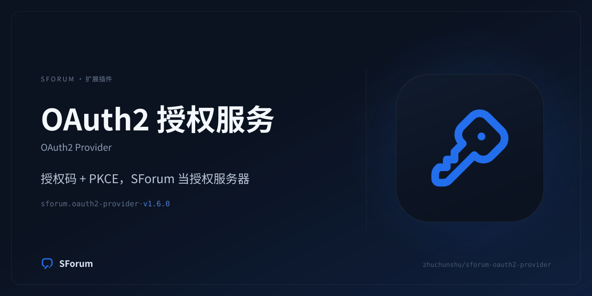

# sforum.oauth2-provider



SForum 的 OAuth2 授权服务器扩展包：第三方应用通过授权码 + PKCE 取得访问令牌，
再用 userinfo 读取用户资料；账号、密码与会话始终由宿主持有。

运营者向的完整说明（安装、配置、授权流程、安全边界）在仓库根
[`README.md`](../../README.md)；本文件只描述这个包本身。

## 包身份

| 字段 | 值 |
| --- | --- |
| 扩展 id | `sforum.oauth2-provider` |
| 包目录 | `plugins/sforum-oauth2-provider` |
| 清单 | `sforum.extension.json`（Manifest V3） |
| 品牌资产 | `brand/icon.svg`、`brand/icon.png`、`brand/social-preview.png` |
| 构建与门禁 | `scripts/prepare-package.sh` |

## 目录

```text
plugins/sforum-oauth2-provider/
├── sforum.extension.json
├── manifest/{settings.json,langs/}
├── backend/            授权码、令牌、内省、撤销、应用管理
├── frontend/           管理端与公开页面组件
├── templates/          授权确认页
├── schemas/            OpenAPI 响应/请求契约
├── openapi/            本包贡献的契约片段
└── brand/              图标与社交卡
```
